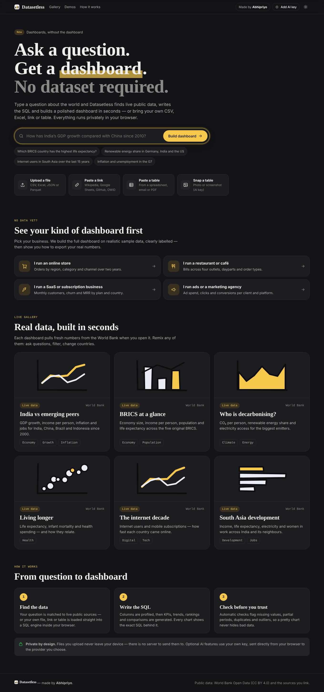
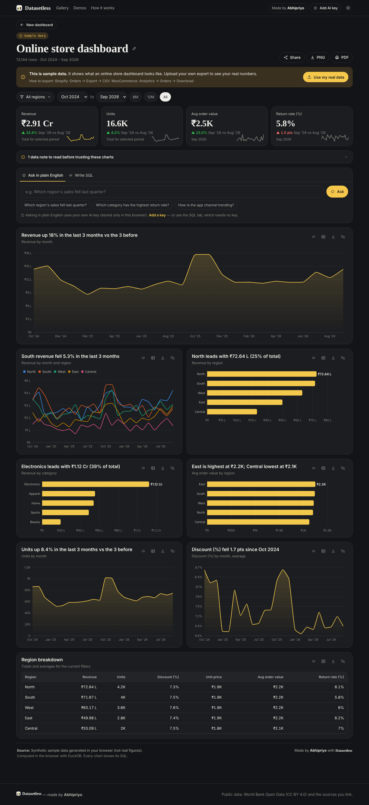

# Datasetless

**Ask a question. Get a dashboard. No dataset required.**

Datasetless turns a plain-English question into a live, professional dashboard. It finds public data itself (World Bank Open Data), or takes your CSV, Excel, JSON, Parquet, a link, a pasted table or even a photo of a table. It writes the SQL, builds KPIs, trends, rankings and comparisons, checks the data for problems, and lets you ask follow-up questions. Everything runs in the browser. There is no backend.

Made by **Abhipriyo**.



## What makes it different

- **No dataset needed.** "How has India's GDP growth compared with China since 2010?" fetches live World Bank data and builds the dashboard. Works with no AI key (keyword planner) and gets smarter with one.
- **Any data in, in seconds.**
  - CSV, TSV, Excel (finds the real header row in messy sheets), JSON and Parquet.
  - Links: Wikipedia articles (table picker), public Google Sheets, GitHub files, Our World in Data charts and direct file URLs.
  - Pasted tables from spreadsheets, emails or Markdown. Values like `₹1,20,000`, `$4.5M` and `12%` are cleaned up automatically.
  - A photo or screenshot of a table (needs an AI key with vision).
- **Try it with your kind of business.** Online store, restaurant, SaaS and agency demos run on realistic sample data that is always labelled as sample. Each demo explains how to export your real numbers.
- **Insight titles, not chart labels.** For example, "South revenue fell 24% in the last 3 months" or "Kestrel Shoes leads with $2.9M (41% of total)".
- **Trust built in.**
  - Every chart shows its SQL and a data table.
  - Automatic checks flag missing values, partial latest periods, lagging country data, duplicates, outliers and negative values.
- **Ask your data.**
  - Plain-English questions return SQL, a chart and a two-sentence explanation, using your own Anthropic, OpenAI or OpenAI-compatible key.
  - A SQL tab works with no key.
  - All generated SQL passes a read-only guard: one SELECT, no file or network access.
- **Share without a database.** The dashboard recipe (source, questions, filters, title, hidden charts) is compressed into the URL. Recipients re-run it live. Uploaded files are never put in links; export a PNG or PDF instead.
- **Professional finish.**
  - Cross-filtering (click a bar, line or dot) and time-range presets.
  - KPI tiles with deltas and sparklines.
  - Light and dark themes with a colour-blind-validated palette.
  - Mobile layout, PNG export, print-to-PDF, and "Made by Abhipriyo" on every dashboard and export.



## Privacy

Uploaded files are loaded into DuckDB-WASM in your browser and never leave the device. There is no server.

AI is optional and bring-your-own-key. The key is stored in `localStorage`, and requests go directly from the browser to the provider. The only data sent to the provider is the column schema, 5 sample rows and the query results being explained.

## Tech

- Vanilla JS and Vite, with no framework.
- [DuckDB-WASM](https://duckdb.org/docs/api/wasm/overview) as the in-browser SQL engine.
- [Apache ECharts](https://echarts.apache.org/) for charts, using the SVG renderer.
- SheetJS for Excel, lz-string for share links, html-to-image for PNG export.

```
src/
  main.js              app shell, routing, source loading pipeline, modals
  config.js            branding and links (override with env vars)
  lib/
    db.js              DuckDB-WASM setup and queries
    load.js            CSV / Excel / JSON / Parquet → table "data"
    parse.js           pasted & HTML table parsing, number cleaning
    profile.js         column classification (time, measure, dimension, id)
    autospec.js        profile → dashboard spec (KPIs, charts, filters)
    query.js           spec + filters → SQL
    insights.js        insight-style chart titles
    checks.js          data-quality checks
    llm.js             bring-your-own-key AI (Claude / OpenAI / compatible)
    sqlguard.js        read-only SQL guard
    share.js           URL-encoded dashboard recipes
    samples.js         realistic sample business datasets
    sources/worldbank.js, sources/links.js
  ui/
    landing.js, dashboard.js, charts.js, components.js
```

## Run locally

```bash
npm install
npm run dev        # http://localhost:5173
npm test           # unit tests
npm run build      # production build in dist/
```

## Configure your branding

Copy `.env.example` to `.env.local`, or set these variables in your host's dashboard:

| Variable | Purpose |
|---|---|
| `VITE_AUTHOR_NAME` | Defaults to `Abhipriyo` |
| `VITE_AUTHOR_URL` | Your portfolio or LinkedIn. Makes every "Made by Abhipriyo" a link. |
| `VITE_CONTACT_URL` | Cal.com, Tally or `mailto:` link. Turns on the "Work with Abhipriyo" client section. |
| `VITE_GITHUB_URL` | Shows a "Source code" link in the footer |
| `VITE_PLAUSIBLE_DOMAIN` | Optional analytics |
| `VITE_DUCKDB_CDN=1` | Loads DuckDB from jsDelivr (needed on Cloudflare Pages, see below) |

## Deploy

It's a static site, so any static host works.

- **Vercel:** import the repo. `vercel.json` is included. Build `npm run build`, output `dist`.
- **Netlify:** import the repo. `netlify.toml` is included.
- **Cloudflare Pages:** build `npm run build`, output `dist`, and set `VITE_DUCKDB_CDN=1`. Pages limits files to 25 MB, and the self-hosted DuckDB WASM file is about 36 MB.
- **GitHub Pages:** works too. Set `VITE_DUCKDB_CDN=1` to keep the deploy small.

## Notes

- World Bank data is national-level, licensed CC BY 4.0, and is attributed on every dashboard.
- Some websites block browser apps from reading them (CORS). When a link fails, the app says so and offers file upload instead.
- The npm build of SheetJS is 0.18.5. For untrusted Excel files at scale, consider switching to the official SheetJS CDN build (`npm i https://cdn.sheetjs.com/xlsx-0.20.3/xlsx-0.20.3.tgz`).

## License

MIT © Abhipriyo
