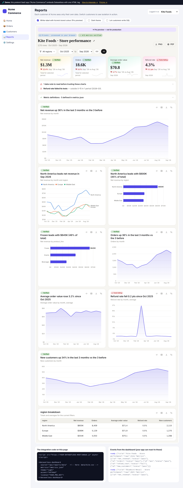

# Datasetless

**Customer-facing analytics that runs inside your app. Your data never touches our servers.**

Datasetless is two things:

1. **A free web app.** Ask a question about the world, or bring a CSV, Excel file, link or table, and get a polished dashboard with SQL, charts, data checks and plain-English answers.
2. **An embeddable product for businesses.** One HTML tag puts the same dashboards inside any company's software (any frontend framework, no-code tool or mobile app). The company's own API decides what each customer sees, and the SQL engine runs in the customer's browser.

Made by **Abhipriyo**.


## What makes it different

| | Typical embedded BI | Datasetless |
|---|---|---|
| Data path | Through the vendor's cloud | Your API → your user's browser. No vendor in the path. |
| Pricing | Often per viewer or per query | Flat per app, unlimited viewers (there are no servers to pay for) |
| Metric definitions | Configured in the vendor's UI | `metrics.json` in your own repo, **tested** on every load |
| AI | Vendor's model and servers | Any model, through your own endpoint, bound to your metric definitions |
| Integration | An SDK per framework | One web component for any stack, an iframe for no-code, a WebView for mobile |
| Filters | Network round trip | Instant: queries run locally (DuckDB-WASM) |

**Built to last as AI improves.** New models make SQL and charts cheaper, and Datasetless uses them for exactly that. What a model can't replace is running inside someone else's product behind their login, enforcing their tested metric definitions, and keeping their customers' data off third-party servers.

## Plans

| | Free | Pro | Business |
|---|---|---|---|
| Web app, dashboards, SQL, data checks, share links, exports | ✓ | ✓ | ✓ |
| Embed anywhere | ✓ with "Powered by" badge | ✓ white-label | ✓ white-label |
| Verified metrics (metrics.json) | up to 5 | unlimited | unlimited |
| AI questions inside your product (your endpoint, any model) | – | ✓ | ✓ |
| Custom accent colour | – | ✓ | ✓ |
| Domains | – | as issued (e.g. 3) | unlimited |
| Self-hosting, onboarding, priority support | – | – | ✓ |

Prices and checkout links are configured with environment variables (see below). Paid plans are unlocked with **signed license keys** that are verified in the browser, so no licensing server is needed. See [docs/SELLING.md](docs/SELLING.md).

## Integration in 30 seconds

```html
<script src="https://YOUR-DATASETLESS-HOST/embed.js" async></script>

<datasetless-dashboard
  source="/api/reports/data"
  metrics="/metrics.json"
  license="YOUR_LICENSE_KEY">
</datasetless-dashboard>
```

Your backend adds one endpoint that returns the logged-in customer's rows (JSON, CSV or Parquet). Examples for Node, Python, Django, Rails, Laravel, Spring, .NET and Go, plus React, Vue, Angular, Next.js, WordPress, Salesforce, iOS, Android, Flutter and React Native, are on the **For developers** page of the app and in [docs/INTEGRATION.md](docs/INTEGRATION.md).



**Live demo:** `/demo/acme.html` is a pretend SaaS app with three customers, each seeing only their own data. It shows verified and failing metrics, the event log and a white-label preview.

## Run locally

```bash
npm install
npm run dev            # http://localhost:5173  (demo: /demo/acme.html)
npm test               # unit tests
npm run build          # production build in dist/
```

## Before you launch: create your license signing key

The repository ships with a public key whose private half is **not** included. Create your own pair once:

```bash
npm run license:keygen          # writes .license/private.pem (secret!) and src/license-key.js
npm run license:issue -- --plan pro --org "Acme Inc" --domains acme.com,*.acme.com --days 365
```

Keep `.license/private.pem` secret and backed up. It's in `.gitignore`; never commit it. Anyone with it can create license keys.

## Configure

Set these in `.env.local` or in your host's environment settings:

| Variable | Purpose |
|---|---|
| `VITE_AUTHOR_NAME` / `VITE_AUTHOR_URL` | "Made by" name and link (defaults to Abhipriyo) |
| `VITE_CONTACT_URL` | Contact or booking link (Cal.com, Tally, `mailto:`) |
| `VITE_CHECKOUT_PRO_URL` / `VITE_CHECKOUT_BUSINESS_URL` | Stripe Payment Link, Lemon Squeezy or Paddle checkout |
| `VITE_PRICE_PRO` / `VITE_PRICE_PRO_YEARLY` / `VITE_PRICE_BUSINESS` | Displayed prices |
| `VITE_SITE_URL` | Your public URL, used by the "Powered by" badge in embeds |
| `VITE_GITHUB_URL`, `VITE_PLAUSIBLE_DOMAIN` | Optional |
| `VITE_DUCKDB_CDN=1` | Load DuckDB-WASM from jsDelivr (needed on hosts with a 25 MB file limit, e.g. Cloudflare Pages) |

## Deploy

It's a static site, so any static host works. Vercel (`vercel.json`) and Netlify (`netlify.toml`) configs are included. Because the build uses relative paths, it also works from a sub-folder or a customer's own CDN (the Business self-host option). Use HTTPS in production.

## How it's built

- Vanilla JS and Vite, with no framework. DuckDB-WASM for in-browser SQL, Apache ECharts (SVG) for charts.
- `src/lib/pipeline.js` loads any source; `autospec.js` designs the dashboard; `metrics.js` applies and tests the metrics contract; `license.js` verifies keys (WebCrypto, with an audited fallback for non-HTTPS pages).
- `public/embed.js` is the loader for host pages (the web component, `Datasetless.mount`, and the postMessage bridge). `src/embed-main.js` is the dashboard inside the iframe.
- AI-written SQL passes a read-only guard: one SELECT, no file or network access.

## Privacy

Uploaded and embedded data is processed in the viewer's browser and is never sent to a Datasetless server. AI is optional. In the web app it uses the visitor's own key. In embeds it calls the host company's own endpoint, which receives column names, 5 sample rows and query results.

## License

MIT © Abhipriyo. The code is open source. Paid plans are commercial licenses for white-label use, AI, unlimited metrics and support.
